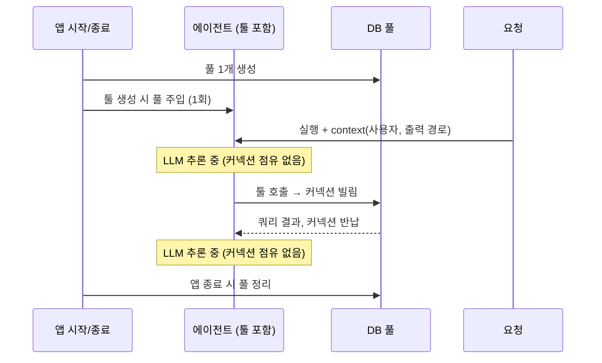

에이전트에게 SQL 실행 툴을 쥐여주는 예제는 많다. 대부분 툴 함수 안에서 DB에 접속하거나, 모듈 맨 위에 만들어 둔 전역 DB 객체를 가져다 쓴다. 노트북에서 한 번 돌려보기엔 충분하지만, 에이전트를 웹 서비스 안에 넣어 여러 요청이 동시에 들어오는 순간 질문이 생긴다. 이 DB 객체는 언제 만들어지고 언제 닫히는가? 테스트에서는 어떻게 가짜로 바꿔 끼우는가? 요청마다 달라지는 값(사용자, 출력 경로 등)은 툴에 어떻게 전달하는가?

최근 데이터 조회용 에이전트를 만들면서 SQL 툴에 DB를 어떻게 넣을지 꽤 오래 고민했고, 그 과정과 결론을 정리해보았다.

## 배경 — 어떤 상황이었나

웹 API 서버 안에 에이전트가 들어 있는 구조였다. 사용자의 질문이 들어오면 에이전트가 필요한 SQL을 만들어 툴로 실행하고, 결과를 요약하거나 파일로 저장해 돌려준다. 조건은 두 가지였다.

1. **DB는 애플리케이션과 에이전트가 함께 쓴다.** 일반 API 핸들러도 DB를 쓰고, 에이전트의 툴도 같은 DB를 쓴다.
2. **에이전트는 실행 도중 여러 번 DB에 접근한다.** 한 번의 요청 안에서 LLM이 생각하고, 툴을 부르고, 결과를 보고 다시 툴을 부르는 일이 반복된다.

여기서 툴이 DB 접근 수단을 어디서 얻을지가 문제였다. 처음 떠올린 선택지는 세 가지였고, 셋 다 걸리는 점이 있었다.

## 고민 1. 전역 객체로 두면 안 되나

가장 쉬운 길은 DB 객체를 모듈 전역에 만들어 두고 툴에서 import해 쓰는 것이다. 두 가지가 마음에 걸렸다.

- **생성과 정리 시점을 제어할 수 없다.** 모듈을 import하는 순간 DB 객체가 만들어진다. 설정이 아직 로드되지 않았거나, 테스트에서 그 모듈을 import만 했을 뿐인데 실제 DB 접속이 준비된다. 종료할 때 누가 닫아줄지도 불분명하다.
- **의존성이 숨는다.** 툴의 시그니처만 봐서는 이 툴이 DB를 쓴다는 사실이 드러나지 않는다. 테스트에서 가짜 DB로 바꾸려면 전역 변수를 패치해야 한다.

이건 **의존성 주입(Dependency Injection)**이 필요한 전형적인 상황이다. 객체가 필요한 것을 스스로 만들거나 전역에서 가져오지 않고, 바깥에서 생성자 등으로 넣어주는 방식이다. 그러면 의존성이 시그니처에 드러나고, 테스트에서는 가짜 구현을 넣으면 된다.

## 고민 2. 그럼 툴이 호출될 때마다 만들면?

전역이 문제라면 툴 안에서 필요할 때 DB 클라이언트를 만들면 되지 않을까. 이걸 판단하려면 먼저 **커넥션 풀**을 짚고 가야 한다.

DB 접속(TCP 연결, 인증, 세션 준비)은 비싸다. 그래서 대부분의 DB 라이브러리는 접속을 몇 개 미리 열어 두고 돌려 쓰는 풀을 둔다. Python의 SQLAlchemy를 예로 들면, `engine`을 만드는 것이 곧 풀 하나를 만드는 것이다.

```python
class DbClient:
    def __init__(self, url: str, **pool_options):
        self.engine = create_async_engine(url, **pool_options)  # 풀 1개 생성

    async def fetch_all(self, sql: str) -> list[dict]:
        async with self.engine.connect() as conn:               # 풀에서 빌림
            result = await conn.execute(text(sql))
            return [dict(row._mapping) for row in result]
        # 블록 종료 → 풀에 반납 (접속은 끊지 않음)

    async def close(self) -> None:
        await self.engine.dispose()                              # 풀 정리
```

`connect()`는 새 접속을 여는 게 아니라 **풀에서 놀고 있는 커넥션을 빌려준다.** 풀이 비어 있을 때만 실제로 새로 접속한다. 블록이 끝나면 커넥션은 풀로 돌아가고, 접속은 살아 있어 다음 호출이 재사용한다. 도서관에 비유하면 engine은 도서관 건물(한 번만 짓는다), `connect()`는 대출, 블록 종료는 반납이다.

Java의 HikariCP, Go의 `database/sql`, Node의 `pg.Pool`도 구조는 같다. 풀 객체는 길게 살고, 커넥션은 잠깐 빌렸다 돌려준다.

이렇게 보면 "툴 호출마다 클라이언트를 만든다"는 선택지는 바로 탈락한다. 클라이언트를 만들 때마다 풀이 새로 생기기 때문이다. 접속을 재사용하려고 풀을 쓰는 건데, 풀을 매번 새로 만들면 의미가 없다.

반대 방향의 실수도 있다. **커넥션 하나를 빌려서 에이전트 실행 내내 들고 있는 것**이다. 에이전트 실행 시간의 대부분은 LLM이 응답을 생성하는 시간이다. 그동안 커넥션은 아무 일도 하지 않으면서 풀의 한 자리를 차지한다. 동시 요청이 풀 크기를 넘으면 뒤의 요청은 LLM이 생각을 마칠 때까지 커넥션을 기다려야 한다. 커넥션은 **툴이 실제로 쿼리를 실행하는 동안만** 빌려야 한다.

## 고민 3. 에이전트 state에 넣으면?

에이전트 프레임워크는 대화 기록과 중간 결과를 담는 state를 가진다. 툴이 state를 읽을 수 있으니 DB 클라이언트도 거기 넣으면 되지 않을까 싶었다.

하지만 state는 **체크포인터가 직렬화해서 저장하는 데이터**다. 대화를 이어가거나 중단된 실행을 재개하려고 state를 DB나 파일에 기록한다. 커넥션이나 풀 객체는 직렬화할 수 없고, 해서도 안 된다. state에는 "다시 불러왔을 때 의미가 있는 값"만 둔다.

## 결론 — 수명에 따라 놓을 자리가 정해진다

세 선택지를 지우고 나니 기준이 보였다. **객체마다 수명이 다르고, 수명이 놓을 자리를 정한다.**

| 대상 | 수명 | 어디서 만들고 어떻게 넣나 |
| --- | --- | --- |
| DB 클라이언트 (풀) | 앱 전체, 1개 | 앱 시작 시 생성 → 툴 객체의 생성자로 주입 |
| 툴 / 에이전트 | 앱 전체, 1개 | 앱 시작 시 한 번 조립 |
| 요청별 값 (사용자, 출력 경로, 대화 ID 등) | 요청 1회 | 에이전트 실행 시 런타임 context로 전달 |
| 커넥션 | 툴 호출 1회 | 쿼리 실행 동안만 풀에서 빌리고 반납 |

한 문장으로 줄이면 이렇다. **앱 수명 객체는 생성자로, 요청 수명 값은 런타임 context로, 커넥션은 호출 한 번 동안만 빌린다.**



### 툴: 공유 자원은 필드로, 요청별 값은 context에서

툴을 함수 대신 객체로 만들고, 앱 전체에서 공유하는 DB 클라이언트는 생성자로 받는다. 요청마다 달라지는 값은 프레임워크가 넘겨주는 런타임 context에서 꺼낸다. 아래는 LangChain의 `ToolRuntime`을 쓴 예시다.

```python
@dataclass
class QueryContext:          # 요청마다 달라지는 값
    output_dir: Path
    max_rows: int = 100_000

class SqlToolkit:
    def __init__(self, db: DbClient):   # 앱 수명 의존성은 생성자로
        self.db = db

    async def run_sql(self, sql: str, runtime: ToolRuntime[QueryContext]) -> str:
        """읽기 전용 SELECT 한 문장을 실행한다."""
        ctx = runtime.context                  # 요청 수명 값은 context에서
        rows = await self.db.fetch_all(sql)    # 커넥션은 이 안에서만 빌림
        return summarize(rows, limit=ctx.max_rows)

    def get_tools(self):
        return [tool(self.run_sql)]
```

여기서 중요한 건 **LLM에게 보이는 입력 스키마**다. 툴의 시그니처는 곧 모델이 채워야 할 인자 목록이 된다. DB 클라이언트나 요청 context가 시그니처에 섞이면 모델이 그 값을 채우려 하거나 스키마가 지저분해진다. 위 구조에서는 DB가 `self`에 들어가 있고, `runtime` 인자는 프레임워크가 스키마에서 자동으로 제외한다. 그래서 **모델은 `sql` 하나만 채우면 된다.**

같은 장치는 다른 프레임워크에도 있다. OpenAI Agents SDK의 `RunContextWrapper`, Pydantic AI의 `RunContext`(`deps`)가 같은 역할을 한다. 이름은 달라도 "실행할 때 넘긴 값을 툴이 받되, 모델에게는 보이지 않게" 한다는 점은 같다.

### 조립: 앱 시작 지점에서 한 번

마지막으로 이 객체들을 누가, 언제 만드는지 정한다. 답은 **앱의 시작·종료 훅**이다. 웹 프레임워크라면 대부분 갖고 있다(FastAPI의 lifespan, Spring의 빈 컨테이너, Express라면 서버 기동 코드).

```python
@asynccontextmanager
async def lifespan(app):
    db = DbClient(settings.db_url, pool_size=5)       # 시작 시 1번
    app.state.agent = build_agent(SqlToolkit(db).get_tools())
    yield
    await db.close()                                  # 종료 시 풀 정리
```

이렇게 객체 그래프 전체를 한 곳에서 조립하는 지점을 **Composition Root**라고 부른다. 여기서만 구체 객체를 만들고, 나머지 코드는 주입받은 것을 쓰기만 한다. 피할 자리는 앞서 본 두 곳이다. 모듈 최상단(import 시점에 생성됨)과 요청 핸들러 안(요청마다 풀과 툴이 다시 생김).

테스트에서는 이 조립만 바꾸면 된다. `SqlToolkit(FakeDb())`로 툴을 만들면 실제 DB 없이 툴의 동작을 검증할 수 있다.

## 정리

| 고민 | 걸린 점 | 결론 |
|---|---|---|
| 전역 객체 | 생성·정리 시점 제어 불가, 숨은 의존성 | 앱 시작 훅에서 만들어 생성자로 주입 |
| 툴 호출마다 생성 | 호출마다 풀이 새로 생김 | 풀은 앱에 1개, 커넥션만 빌림 |
| 커넥션을 실행 내내 보유 | LLM 추론 중에도 점유 → 풀 고갈 | 쿼리 실행 동안만 빌리고 반납 |
| 에이전트 state에 저장 | state는 직렬화 대상 | 요청별 값은 런타임 context로 |

핵심 takeaway:

1. **객체를 수명으로 분류하면 놓을 자리가 정해진다.** 앱 수명은 생성자, 요청 수명은 런타임 context, 호출 수명은 함수 안. 헷갈릴 때는 "이건 언제 만들어지고 언제 사라져야 하나"부터 묻는다.
2. **풀은 길게, 커넥션은 짧게.** 풀 객체는 앱에 하나만 두고, 커넥션은 실제 쿼리를 실행하는 순간에만 빌린다.
3. **에이전트에서는 "짧게"의 기준이 더 엄격하다.** 실행 시간 대부분이 LLM 추론이므로, 실행 단위로 커넥션을 잡으면 일반 API보다 훨씬 빨리 풀이 고갈된다.
4. **툴 시그니처는 모델이 채울 것만 남긴다.** 인프라 의존성과 요청 context는 객체 필드나 프레임워크의 런타임 주입으로 빼서 스키마를 깨끗하게 유지한다.
5. **state는 저장될 데이터를 위한 자리다.** 직렬화할 수 없는 자원(커넥션, 클라이언트)은 state에 넣지 않는다.
